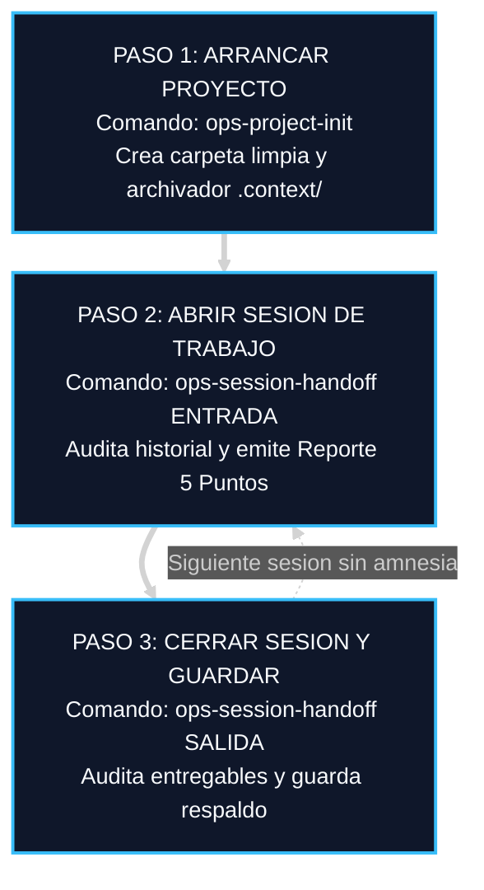
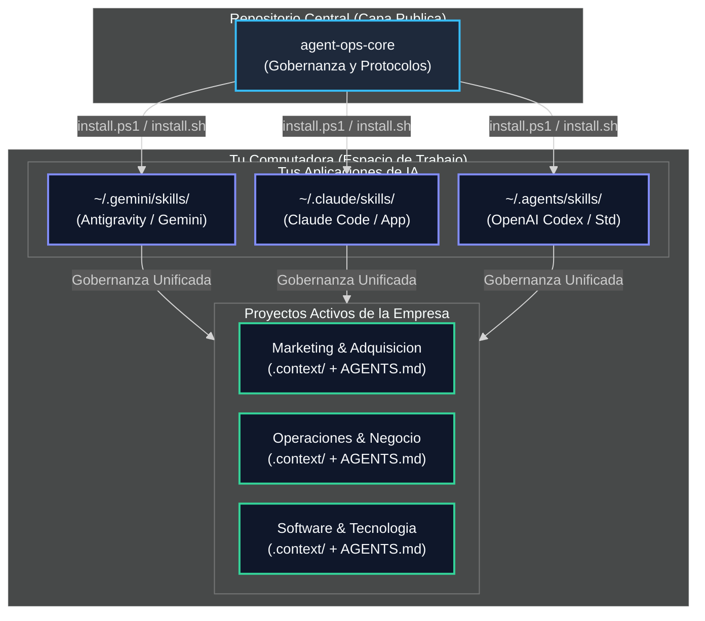
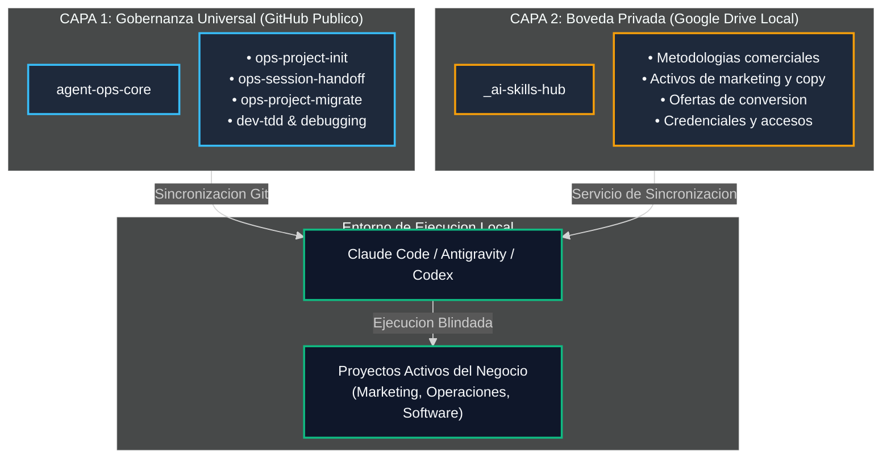

<div align="center">

# Agent Ops Core

### Memoria Persistente y Protocolos de Ejecución para Profesionales y Negocios que Trabajan con Inteligencia Artificial.

**Deja de quemar horas reexplicando tu negocio en cada chat. Dale a tu IA una memoria permanente en tu computadora, verificación de avances sin complacencia y cero amnesia entre sesiones.**

[-818cf8?style=flat-square)]()
[-38bdf8?style=flat-square)]()
[-10b981?style=flat-square)]()
[](LICENSE)

[Arranque en 60s](#como-arrancar-en-60-segundos-cero-codigo) · [Flujo Diario en 3 Pasos](#el-flujo-de-trabajo-diario-en-3-pasos) · [Cuellos de Botella](#por-que-funciona-los-cuatro-cuellos-de-botella-que-resuelve) · [Diagramas](#compatibilidad-universal-y-distribucion-simetrica) · [Los 6 Protocolos](#los-seis-protocolos-universales-de-agentsmd) · [Aviso Legal](#licencia-y-aviso-legal-de-independencia)

</div>

> [!IMPORTANT]
> **Tus Datos y tu Memoria Están a Salvo:**
> Toda IA dejada a su suerte improvisa supuestos, inventa conclusiones complacientes y olvida el contexto al cerrar la ventana. **Agent Ops Core** convierte a tu IA en un asistente disciplinado: ningún agente puede afirmar que una tarea está terminada sin comprobarla físicamente, ningún archivo se modifica a ciegas y la memoria histórica de tu negocio queda blindada localmente bajo control de versiones y respaldo seguro en la nube.

---

## Qué es este Sistema (En 30 Segundos y Sin Tecnocracia)

Si utilizas ChatGPT, Claude, Gemini o Antigravity para trabajar en marketing, investigación, operaciones o desarrollo, conoces exactamente este problema:
Abres una conversación nueva y la IA **ya olvidó quién es tu cliente, qué acordaron ayer o cómo te gusta trabajar**. Tienes que volver a explicarle todo desde cero, o peor aún, confiarte y descubrir que inventó datos o entregó un documento a medias diciendo con entusiasmo que *"está terminado"*.

**Agent Ops Core resuelve esto dándole a tu IA dos cosas:**
1. **Un Archivador Digital Inteligente (`.context/`):** Cinco libretas sencillas en tu computadora donde la IA consulta quién es el cliente, qué directrices debe seguir, qué tareas están hechas y qué errores no debe repetir jamás.
2. **Un Protocolo de Disciplina:** La IA tiene prohibido inventar supuestos. Si le falta información, te hace una pregunta directa en vez de adivinar. Y no puede dar nada por terminado sin antes comprobar que los archivos, cifras y entregables están completos.

---

## Cómo Arrancar en 60 Segundos (Cero Código)

No necesitas ser programador, compilar herramientas ni memorizar comandos técnicos. Solo copia y pega este bloque en el chat de tu IA favorita (**Claude Desktop**, **ChatGPT**, **Gemini**, **Cursor** o **Antigravity**):

```text
Actúa como mi Coordinador de Operaciones y Gobernanza de Proyectos.

Quiero que gestionemos este proyecto bajo el estándar de AGENTS.md del repositorio público https://github.com/eddvasquez/agent-ops-core.

Por favor realiza lo siguiente de forma estricta:
1. Revisa las directrices de https://raw.githubusercontent.com/eddvasquez/agent-ops-core/main/README.md y los 6 Protocolos de AGENTS.md.
2. Adopta de inmediato el Protocolo 1 (MODO ENTRADA): audita el estado actual de nuestro proyecto y los archivos de memoria en .context/ y entrégame el Reporte de 5 Puntos antes de realizar cualquier cambio, propuesta o entregable.
3. Aplica la regla de Cero Suposición y Cero Complacencia: si falta información crítica, formúlame una pregunta bloqueante en lugar de adivinar, y no des ninguna tarea por terminada sin antes verificarla físicamente.
```

---

### (Opcional) Instalación Permanente en tu Computadora (1 Solo Comando)

Si prefieres que todas tus sesiones locales de Claude Code, Antigravity o Codex compartan automáticamente las skills maestras sin tener que pegar el prompt cada vez:

* **En Windows (PowerShell):**
  ```powershell
  irm https://raw.githubusercontent.com/eddvasquez/agent-ops-core/main/install.ps1 | iex
  ```
* **En macOS y Linux (Terminal):**
  ```bash
  curl -fsSL https://raw.githubusercontent.com/eddvasquez/agent-ops-core/main/install.sh | bash
  ```

> [!TIP]
> El instalador detecta automáticamente si cuentas con Google Drive o almacenamiento cloud configurado, valida la sincronización y programa una actualización diaria silenciosa sin interrumpir tu trabajo.

---

## El Flujo de Trabajo Diario en 3 Pasos

Una vez activado el sistema, así trabajas día a día con tu IA:



### 1. Paso 1: Arrancar un Proyecto Nuevo
Dile a tu IA:
> *"Usa `ops-project-init` para crear el proyecto [Nombre]"*

La IA crea la carpeta protegida, comprueba que esté respaldada en tu almacenamiento cloud (Google Drive) para evitar pérdidas y genera el archivador `.context/` con sus 5 libretas de memoria.

### 2. Paso 2: Abrir Sesión de Trabajo (Modo Entrada)
Al comenzar el día o abrir un nuevo chat, dile:
> *"Iniciemos turno con `ops-session-handoff` MODO ENTRADA"*

La IA tiene prohibido tocar archivos o improvisar. Primero revisa qué se avanzó ayer, qué directrices están vigentes y te entrega el **Reporte de 5 Puntos** (estado del proyecto, reglas activas y siguiente paso inmediato). Solo tienes que responder "OK" para autorizar el avance.

### 3. Paso 3: Cerrar Sesión y Guardar (Modo Salida)
Al terminar la jornada o antes de cerrar el chat, dile:
> *"Terminamos por hoy, ejecuta `ops-session-handoff` MODO SALIDA"*

La IA comprueba qué tareas se completaron con evidencia real, anota los aprendizajes o correcciones del día en la libreta de lecciones, actualiza la bitácora y sella una copia de seguridad automática respaldada en tu nube.

---

## Por Qué Funciona: Los Cuatro Cuellos de Botella que Resuelve

### 1. La Amnesia de Turno y la Reexplicación Crónica
- **El Coste:** En cada nuevo chat, la IA olvida el perfil del cliente, las cifras de la oferta, el tono de marca y las objeciones previas. Pierdes entre 20 y 45 minutos de tu jornada repitiendo antecedentes en cada chat.
- **La Solución Agent Ops:** Memoria persistente en Markdown nativo (`.context/`). La IA lee el estado exacto antes de escribir una sola palabra.

### 2. La Complacencia del Falso Avance
- **El Coste:** El modelo afirma con entusiasmo que un copy, un informe de mercado o un script de ventas está "listo", pero al inspeccionarlo contiene datos genéricos, números inventados o instrucciones a medio hacer.
- **La Solución Agent Ops:** Mandato anti-complacencia. Queda prohibido marcar hitos como terminados sin evidencia física comprobable y contrastada contra criterios objetivos de éxito.

### 3. La Modificación Especulativa (Parches a Ciegas)
- **El Coste:** Ante un error o retroalimentación, la IA pide disculpas serviles y altera variables al azar (*shotgun approach*), dañando la coherencia del resto de entregables.
- **La Solución Agent Ops:** Depuración sistemática en 4 fases: aislamiento del síntoma, análisis de causa raíz, hipótesis única y corrección quirúrgica controlada.

### 4. La Dispersión de Datos y la Pérdida de Archivos
- **El Coste:** Archivos dispersos sin versionar, versiones duplicadas informales (`documento_final_v2.docx`) y riesgo de pérdida absoluta si la plataforma del proveedor sufre una caída o bloquea la cuenta.
- **La Solución Agent Ops:** Neutralidad e independencia total. El conocimiento y la memoria residen en tu equipo y tu nube bajo Git, legibles por cualquier IA de hoy o de mañana.

---

## Comparativa de Rendimiento Operativo

| Dimensión | Operación Sin Gobernanza (Tradicional) | Operación Con Agent Ops Core |
| :--- | :--- | :--- |
| **Continuidad entre Sesiones** | Amnesia recurrente; el usuario debe reexplicar el contexto en cada turno. | Protocolo de Relevo (Modo Entrada): auditoría del estado real y confirmación de foco. |
| **Calidad de Entregables** | Contenido genérico y complaciente sin verificación rigurosa. | Validación contra criterios de éxito explícitos y memoria de lecciones aprendidas. |
| **Resolución de Incidencias** | Modificaciones a ciegas (*shotgun approach*) que generan retrabajos. | Análisis determinista de causa raíz antes de intervenir cualquier activo. |
| **Independencia Tecnológica** | Dependencia absoluta del ecosistema de un solo proveedor. | Neutral: Las mismas reglas operan idénticas en Claude, Gemini, ChatGPT y terminales locales. |
| **Seguridad de Archivos** | Riesgo de pérdida por daño físico o sobreescritura accidental. | Auditoría automática de almacenamiento en la nube y versionado Git protegido. |

---

## Las 6 Habilidades Maestras que Adquiere tu IA

| Habilidad | Tipo | Función Crítica y Resultado Tangible |
| :--- | :---: | :--- |
| **`ops-project-init`** | Operación | Inicializa proyectos nuevos con arquitectura v2, Git protegido y auditoría preventiva de respaldo en Google Drive/Cloud. |
| **`ops-session-handoff`** | Gobernanza | Ejecuta el protocolo de relevo diario (Modo Entrada y Modo Salida) con auto-actualización silenciosa cada 24 horas. |
| **`ops-project-migrate`** | Operación | Convierte proyectos legados o desordenados a la arquitectura universal v2 sin destruir datos ni duplicar archivos. |
| **`ops-git-worktrees`** | Operación | Gestiona espacios de trabajo paralelos para abordar tareas simultáneas sin interferencias ni bloqueos. |
| **`dev-tdd`** | Calidad | Implementa el principio de "revisar antes de publicar", garantizando que ningún entregable se apruebe sin pruebas de consistencia. |
| **`dev-systematic-debugging`** | Resolución | Metodología de 4 fases para investigar y resolver incidencias de causa raíz sin parches a ciegas ni improvisación. |

---

## Compatibilidad Universal y Distribución Simétrica

El sistema de gobernanza reside en una capa independiente y universal. Ninguna empresa corporativa (Claude, OpenAI, Google) es propietaria de la memoria de tu negocio:



---

## Arquitectura de Trabajo en Dos Capas

El framework separa de forma estricta los procesos operativos de los activos propietarios del negocio:



1. **Capa 1: Marco de Gobernanza (`agent-ops-core` en GitHub):**
   - Protocolo universal `AGENTS.md`.
   - Inicializador de proyectos (`ops-project-init`).
   - Gestión de relevos y recepción/cierre de turnos (`ops-session-handoff`).
   - Estandarización y rescate de proyectos legados (`ops-project-migrate`).
   - Aislamiento de tareas paralelas (`ops-git-worktrees`).
   - Protocolos de verificación y depuración de causa raíz.

2. **Capa 2: Bóveda Privada de Negocio (Almacenamiento Local Respaldado):**
   - Habilidades propietarias de la empresa: marcos de consultoría, ángulos de adquisición, guiones comerciales y credenciales.
   - Reside exclusivamente en tu almacenamiento respaldado y privado, sin exposición en repositorios públicos.
   - Servicios de sincronización en segundo plano unifican ambas capas en tus aplicaciones de IA en tiempo real.

---

## Ciclo de Vida Operativo: Protocolo de Relevo

Así interactúas tú, los asistentes de Inteligencia Artificial y la copia de seguridad en cada sesión de trabajo:


---

## Los Seis Protocolos Universales de AGENTS.md

Todo proyecto iniciado con este framework incluye un archivo rector `AGENTS.md` con seis reglas innegociables:

1. **Protocolo 1 (Inicio de Turno / Auditoría de Estado):** Prevalencia de la evidencia física de Git y los registros de contexto sobre suposiciones verbales. Reporte de 5 puntos obligatorio antes de modificar activos.
2. **Protocolo 2 (Cero Suposiciones y Memoria Cruda):** Prohibido adivinar requerimientos o directrices del cliente. Toda corrección humana se registra cronológicamente en `.context/lessons_learned.md`.
3. **Protocolo 3 (Invocación Mandatoria y Anti-Racionalización):** Prohibido omitir habilidades o metodologías probadas con excusas de premura.
4. **Protocolo 4 (Destilación de Conocimiento):** Las reglas operativas que demuestren valor universal se abstraen hacia habilidades maestras reutilizables.
5. **Protocolo 5 (Escritor Único e Higiene en la Nube):** Un único agente activo por turno para prevenir colisiones; prohibición de archivos duplicados; pausas de seguridad para liberar bloqueos de sincronización en la nube.
6. **Protocolo 6 (Cierre de Turno y Relevo):** Auditoría objetiva de tareas terminadas antes de actualizar el progreso y generación de commit atómico de relevo.

---

## Licencia y Aviso Legal de Independencia

Este proyecto está distribuido bajo la Licencia [Apache 2.0](LICENSE).

**Aviso de Independencia y Marcas:** Agent Ops Core es un marco de gobernanza independiente desarrollado por Edd Vásquez. No está afiliado, patrocinado, respaldado ni certificado por Google LLC, Anthropic PBC, OpenAI ni ninguna de sus entidades filiales. Todas las marcas registradas y nombres de productos mencionados pertenecen a sus respectivos titulares.
