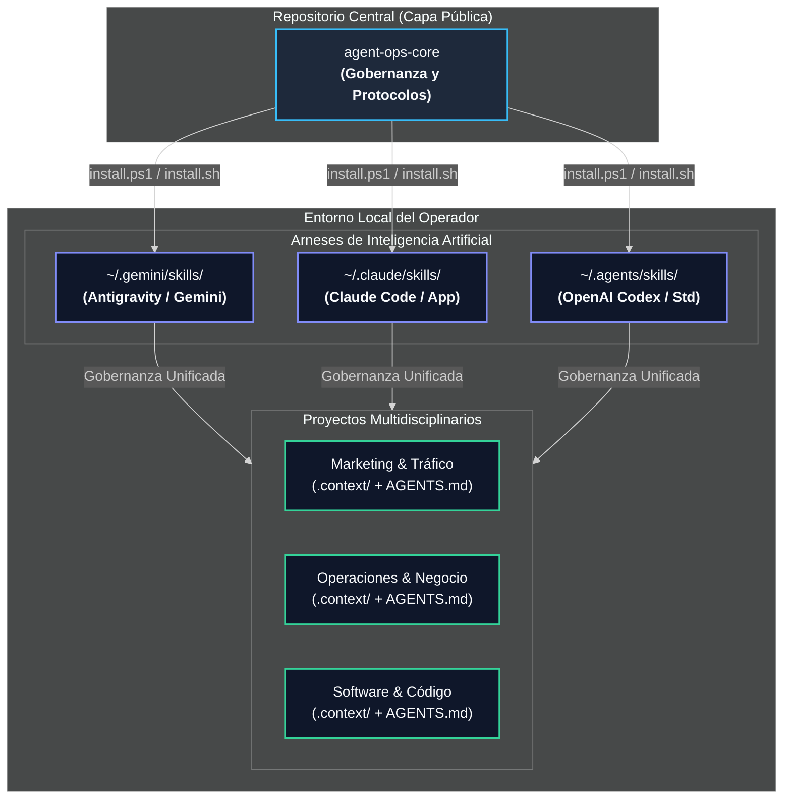
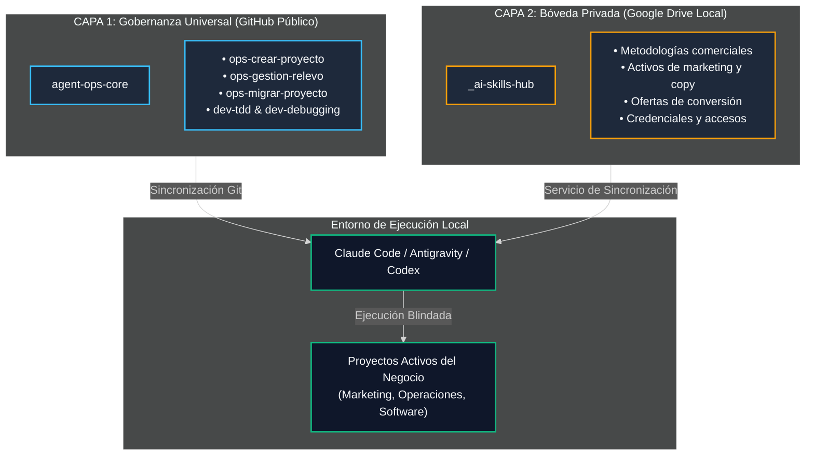

# Agent Ops Core

### Sistema de Gobernanza Operativa y Memoria Persistente para Equipos de Inteligencia Artificial.

El principal obstáculo al delegar operaciones complejas en modelos de Inteligencia Artificial (Claude, Gemini, Codex) no es su capacidad intelectual, sino la **ausencia de gobernanza y trazabilidad**.

Sin protocolos operativos formales, cualquier IA padece tres fallas estructurales:
1. **Amnesia de sesión:** Olvida decisiones estratégicas previas y contradice acuerdos comerciales o técnicos alcanzados en turnos anteriores.
2. **Complacencia no verificada:** Da por concluidas tareas de marketing, análisis financiero o redacción sin aplicar criterios objetivos de validación.
3. **Dependencia de plataforma:** Deja la memoria de tu negocio secuestrada dentro de la interfaz propietaria de un único proveedor corporativo.

**Agent Ops Core** establece un estándar neutral, multiplataforma y versionado en Git que transforma el caos conversacional en un sistema disciplinado de ejecución para proyectos de **estrategia comercial, marketing digital, operaciones de oficina, gestión de clientes y desarrollo técnico**.

---

## Instalación Universal

En segundos, el instalador despliega los protocolos operativos en los entornos locales de Claude, Gemini y Codex:

### En Windows (PowerShell):
```powershell
irm https://raw.githubusercontent.com/eddvasquez/agent-ops-core/main/install.ps1 | iex
```

### En macOS y Linux (Bash / Zsh):
```bash
curl -fsSL https://raw.githubusercontent.com/eddvasquez/agent-ops-core/main/install.sh | bash
```

### Para Usuarios No Programadores (Copiar y Pegar en el Chat de tu IA)

Si no deseas utilizar la terminal, copia y pega el siguiente bloque directamente en la ventana de chat de Claude Desktop, ChatGPT o Gemini:

```text
Actúa como mi Ingeniero de Operaciones y Gobernanza de Proyectos. 

Quiero que trabajemos bajo el estándar universal de AGENTS.md del repositorio https://github.com/eddvasquez/agent-ops-core.

Por favor realiza lo siguiente:
1. Revisa las instrucciones públicas de https://raw.githubusercontent.com/eddvasquez/agent-ops-core/main/README.md y los 6 Protocolos de AGENTS.md.
2. Si tienes acceso a mi terminal o herramientas locales, ejecuta el comando de instalación de 1 línea para mi sistema operativo (Windows o Mac/Linux) para instalar las skills operativas en mis carpetas locales (~/.gemini, ~/.claude o ~/.agents).
3. Si estamos operando únicamente en esta ventana de chat sin acceso local a terminal, adopta inmediatamente el Protocolo 1 (MODO ENTRADA): audita nuestro objetivo, verifica qué directrices tenemos y entrégame el Reporte de 5 Puntos antes de realizar cualquier cambio o generar código.
```

---

## Los Cuatro Cuellos de Botella que Resuelve Este Sistema

### 1. La Amnesia de Turno y la Desalineación de Objetivos
- **El Problema:** Al abrir una nueva conversación, la IA desconoce el contexto histórico del cliente, los números de la oferta, las directrices de marca o las restricciones presupuestarias.
- **La Solución:** La arquitectura `.context/` mantiene cinco registros vivos en Markdown nativo (`projectbrief.md`, `systemPatterns.md`, `activeContext.md`, `progress.md`, `lessons_learned.md`). La IA asimila el estado exacto del proyecto antes de ejecutar cualquier acción.

### 2. La Complacencia y el Falso Avance
- **El Problema:** El agente afirma que una tarea de investigación, un copy de ventas o una configuración publicitaria está "terminada", cuando en realidad omitió pasos críticos o introdujo datos genéricos.
- **La Solución:** Protocolo de verificación objetiva. Queda prohibido marcar un hito como completado sin evidencia comprobable (revisión de fuentes, pruebas unitarias o confirmación física de entregables).

### 3. La Modificación Especulativa
- **El Problema:** Ante un error operativo o inconsistencia en datos, los modelos tienden a parchar los síntomas cambiando supuestos al azar, corrompiendo la coherencia de los entregables adyacentes.
- **La Solución:** Metodología sistemática de resolución en cuatro fases: aislamiento del escenario, diagnóstico de causa raíz, formulación de hipótesis única y corrección quirúrgica.

### 4. La Vulnerabilidad de Datos y Pérdida de Información
- **El Problema:** Proyectos dispersos en discos locales sin sincronización, sujetos a pérdida total ante fallas del equipo físico, o colisiones por duplicidad de archivos con nombres informales (`brief_v2`, `final_final`).
- **La Solución:** Auditoría obligatoria de respaldo en Google Drive o almacenamiento cloud, prohibición taxativa de duplicados informales y control de versiones atómico con Git.

---

## Comparativa de Rendimiento Operativo

| Dimensión | Operación Sin Gobernanza (Tradicional) | Operación Con Agent Ops Core |
| :--- | :--- | :--- |
| **Continuidad entre Sesiones** | Amnesia recurrente; el usuario debe reexplicar el contexto en cada turno. | Protocolo de Relevo (Modo Entrada): auditoría del estado real y confirmación de foco. |
| **Calidad de Entregables** | Contenido genérico y complaciente sin verificación rigurosa. | Validación contra criterios de éxito explícitos y memoria de lecciones aprendidas. |
| **Resolución de Incidencias** | Modificaciones a ciegas (*shotgun approach*) que generan retrabajos. | Análisis determinista de causa raíz antes de intervenir cualquier activo. |
| **Independencia Tecnológica** | Dependencia absoluta del ecosistema de un solo proveedor. | Neutral: Las mismas reglas operan idénticas en Claude, Gemini, ChatGPT y terminales locales. |
| **Seguridad de Archivos** | Riesgo de pérdida por daño físico o sobreescritura accidental. | Auditoría automática de almacenamiento en la nube y versionado Git protegido. |

---

## Neutralidad Multiagente y Distribución Simétrica

El sistema de gobernanza reside en una capa independiente y universal. Ningún arnés ni empresa de IA es propietaria de tu estructura de trabajo:



---

## Arquitectura de Trabajo en Dos Capas

El framework separa de forma estricta los procesos operativos de los activos propietarios del negocio:



1. **Capa 1: Marco de Gobernanza (`agent-ops-core` en GitHub):**
   - Protocolo universal `AGENTS.md`.
   - Inicializador de proyectos multidisciplinarios (`ops-crear-proyecto`).
   - Gestión de relevos y recepción/cierre de turnos (`ops-gestion-relevo`).
   - Estandarización y rescate de proyectos legados (`ops-migrar-proyecto`).
   - Aislamiento de tareas paralelas (`ops-git-worktrees`).
   - Protocolos de verificación y depuración de causa raíz.

2. **Capa 2: Bóveda Privada de Negocio (Almacenamiento Local Respaldado):**
   - Habilidades propietarias de la empresa: marcos de consultoría, ángulos de adquisición, guiones comerciales y credenciales.
   - Reside exclusivamente en tu almacenamiento respaldado y privado, sin exposición en repositorios públicos.
   - Servicios de sincronización en segundo plano unifican ambas capas en los arneses de IA en tiempo real.

---

## Ciclo de Vida Operativo: Protocolo de Relevo

Así interactúan el operador, los agentes de Inteligencia Artificial y el control de versiones en cada turno de trabajo:


---

## Los Seis Protocolos Universales de AGENTS.md

Todo proyecto iniciado con este framework incluye un archivo rector `AGENTS.md` con seis reglas innegociables:

1. **Protocolo 1 (Inicio de Turno / Auditoría de Estado):** Prevalencia de la evidencia física de Git y los registros de contexto sobre suposiciones verbales. Reporte de 5 puntos obligatorio antes de modificar activos.
2. **Protocolo 2 (Cero Suposiciones y Memoria Cruda):** Prohibido adivinar requerimientos o directrices del cliente. Toda corrección humana se registra cronológicamente en `.context/lessons_learned.md`.
3. **Protocolo 3 (Invocación Mandatoria y Anti-Racionalización):** Prohibido omitir habilidades o metodologías probadas con excusas de premura.
4. **Protocolo 4 (Destilación de Conocimiento):** Las reglas operativas que demuestren valor universal se abstraen hacia habilidades maestras reutilizables.
5. **Protocolo 5 (Escritor Único e Higiene en la Nube):** Un único agente activo por turno para prevenir colisiones; prohibición de archivos duplicados; pausas de seguridad para liberar bloqueos de sincronización en la nube.
6. **Protocolo 6 (Cierre de Turno y Relevo):** Auditoría objetiva de tareas terminadas antes de actualizar el progreso y generación de commit atómico de relevo.

---

## Licencia y Aviso Legal de Independencia

Este proyecto está distribuido bajo la Licencia [Apache 2.0](LICENSE).

**Aviso de Independencia y Marcas:** Agent Ops Core es un marco de gobernanza independiente desarrollado por Edd Vásquez. No está afiliado, patrocinado, respaldado ni certificado por Google LLC, Anthropic PBC, OpenAI ni ninguna de sus entidades filiales. Todas las marcas registradas y nombres de productos mencionados pertenecen a sus respectivos titulares.
