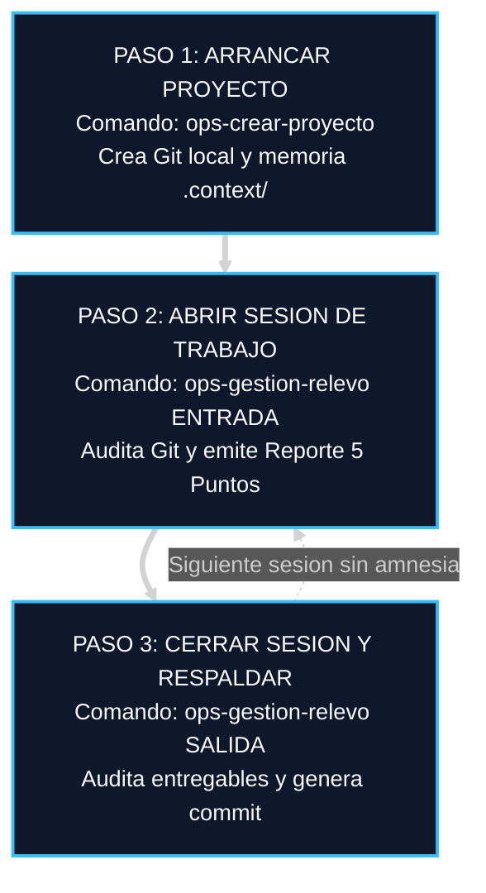
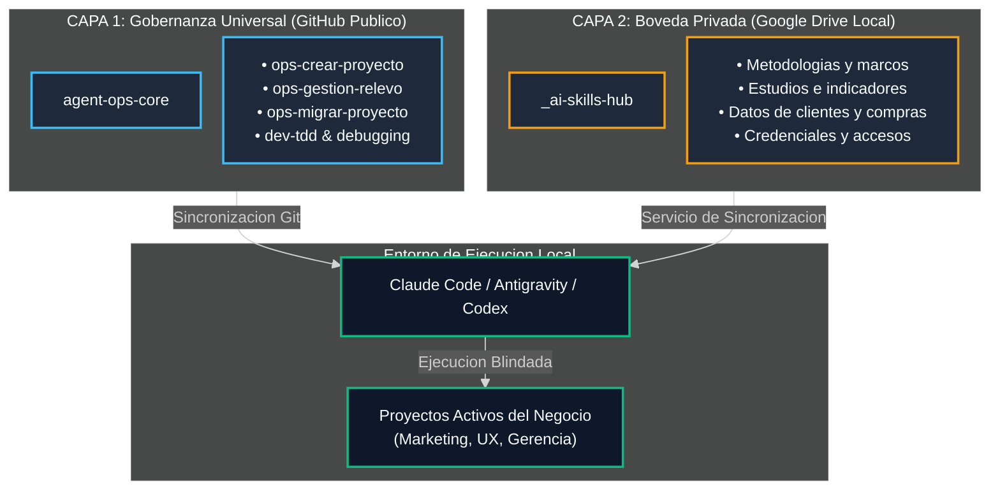
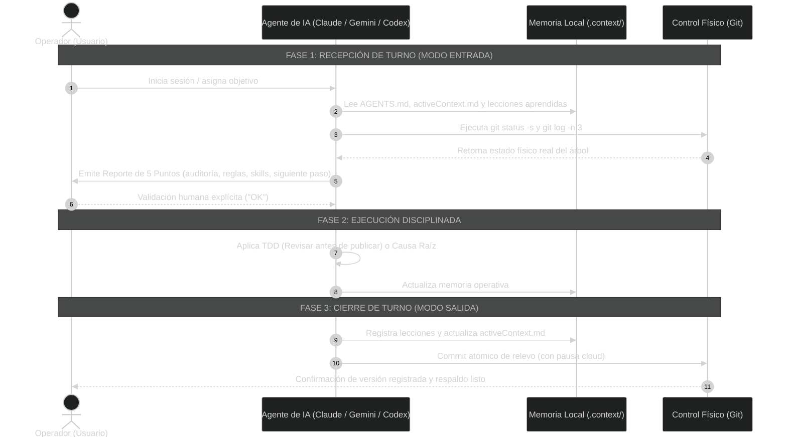

<div align="center">

# Agent Ops Core

### El Sistema de Memoria Persistente y Gobernanza Operativa para Equipos de Marketing, Experiencia de Usuario (UX) y Gerencia Administrativa.

**Deja de quemar horas reexplicando tu negocio en cada chat. Dale a tu IA una memoria física indestructible, rigor analítico en datos y disciplina de oficina para operar sin amnesia ni complacencia.**

[-818cf8?style=flat-square)]()
[]()
[]()
[](LICENSE)
[](#el-catalogo-de-las-6-skills-operativas-explicadas-para-negocios)

[Arranque en 60s](#como-arrancar-este-sistema-en-60-segundos-cero-codigo) · [Para tu Área](#que-hace-este-sistema-por-tu-area-en-palabras-simples) · [Glosario Sin Jerga](#glosario-para-no-programadores-de-terminos-tecnicos-a-beneficio-real) · [Flujo Diario](#el-flujo-de-trabajo-diario-en-3-pasos) · [Casos Reales](#casos-de-uso-reales-como-opera-el-sistema-en-el-dia-a-dia) · [Diagramas](#neutralidad-multiagente-y-distribucion-simetrica) · [Aviso Legal](#licencia-y-aviso-legal-de-independencia)

</div>

> [!IMPORTANT]
> **Tus Datos, Decisiones y Memoria Están a Salvo:**
> Toda IA dejada a su suerte improvisa supuestos, inventa conclusiones complacientes y olvida el contexto al cerrar la ventana. **Agent Ops Core** impone un estándar físico: ningún agente puede afirmar que una tarea está terminada sin evidencia comprobable, ningún archivo se modifica a ciegas y la memoria histórica de tu negocio queda blindada localmente bajo control de versiones Git y respaldo cloud.

---

## Qué Hace este Sistema por tu Área (En Palabras Simples)

Si no eres programador y lideras o integras equipos de negocio, reconoces la mayor frustración de la IA actual: **la amnesia crónica y la complacencia**. Abres un nuevo chat y el asistente ya olvidó lo que acordaron ayer, inventa supuestos o te entrega un trabajo superficial diciendo que "está terminado".

**Agent Ops Core elimina esta fuga operativa dotando a tu IA de un archivador físico estructurado y reglas innegociables:**

### 1. Para Equipos de Marketing y Adquisición (Media Buyers, Copywriters, Estrategas)
* **Tu Briefing Maestro Inteligente:** En lugar de pegar el perfil del cliente, la oferta y los precios 50 veces a la semana, la IA los consulta directamente en `.context/projectbrief.md`.
* **Cero Desalineación de Marca:** Toda propuesta publicitaria, guion de VSL o landing page se audita contra los pilares de la oferta y las directrices aprendidas de campañas anteriores.

### 2. Para Equipos de Experiencia de Usuario (UX Research, Analistas de Encuestas y Producto)
* **Análisis Forense de Sondeos y Encuestas:** Cuando alimentas a la IA con 500 respuestas de clientes, NPS, entrevistas o estudios de campo, el sistema le prohíbe inventar tendencias o alucinar datos.
* **Trazabilidad de Indicadores a Tableros:** Cada hallazgo, métrica de fricción o recomendación de diseño mantiene trazabilidad con la muestra original de usuarios. Los tableros e informes ejecutivos se actualizan sin contradicciones históricas.

### 3. Para Equipos de Gerencia Administrativa y Finanzas (Operaciones, Compras, Gestión)
* **Manual de Procedimientos (SOP) con Cumplimiento Ciego:** La IA está obligada a consultar las políticas internas, condiciones comerciales de proveedores y tablas de tarifas vigentes.
* **Principio de Cero Suposición:** Si falta un dato contable, legal o contractual, la IA se detiene y formula una pregunta bloqueante. Nunca inventa cláusulas ni datos financieros.
* **Bitácora Sellada y Respaldo Cloud:** Cada sesión de trabajo termina con una copia de seguridad automática en tu almacenamiento corporativo (Google Drive / Cloud).

---

## Glosario para No Programadores: De Términos Técnicos a Beneficio Real

No necesitas aprender a programar para aprovechar el poder de este sistema. Aquí tienes la traducción exacta de los términos que verás:

| Término Técnico | ¿Qué Significa Realmente para Tu Trabajo Diario? |
| :--- | :--- |
| **Git** | **Tu Máquina del Tiempo de Seguridad:** Toma una "fotografía" sellada de tu trabajo al cerrar sesión. Si la IA o un compañero comete un error, puedes regresar al documento exacto de ayer en 1 segundo. |
| **`.context/`** | **El Archivador Digital de 5 Libretas:** Carpeta donde la IA consulta: quién es el cliente o proyecto (`projectbrief.md`), cómo se trabaja (`systemPatterns.md`), qué se hace hoy (`activeContext.md`), qué está terminado (`progress.md`) y qué errores no debe repetir jamás (`lessons_learned.md`). |
| **TDD / Verificación** | **Revisar Antes de Publicar:** La IA tiene prohibido dar por terminada una tarea (un análisis de sondeo, una campaña o una cotización) sin antes comprobar que los datos cuadran y los archivos existen. |
| **Commit de Relevo** | **Firmar la Bitácora al Salir:** Guarda los avances, anota el estado exacto del proyecto y deja la copia de respaldo en la nube para que cualquiera continúe mañana sin perder el hilo. |
| **Neutralidad Multiagente** | **Tu Información es Tuya:** Puedes trabajar hoy en Claude, mañana en ChatGPT y pasado mañana en Gemini. Todas leen y actualizan el mismo archivador sin amnesia. |

---

## Cómo Arrancar este Sistema en 60 Segundos (Cero Código)

No necesitas compilar dependencias ni memorizar comandos técnicos. Elige el prompt adaptado a tu rol y pégalo en tu aplicación de IA favorita (**Claude Desktop**, **ChatGPT**, **Gemini**, **Cursor** o **Antigravity**):

### Opción 1: Para Marketing y Adquisición
```text
Actúa como mi Director de Operaciones de Marketing y Media Buying.

Quiero que gestionemos nuestras campañas y activos bajo el estándar universal de AGENTS.md de https://github.com/eddvasquez/agent-ops-core.

Por favor realiza lo siguiente de forma estricta:
1. Revisa las directrices públicas de https://raw.githubusercontent.com/eddvasquez/agent-ops-core/main/README.md y los 6 Protocolos de AGENTS.md.
2. Adopta de inmediato el Protocolo 1 (MODO ENTRADA): audita el objetivo de marketing de nuestro proyecto, revisa el perfil del cliente, la oferta y los datos del brief en .context/ y entrégame el Reporte de 5 Puntos antes de redactar copies, proponer anuncios o sugerir cambios de presupuesto.
3. Aplica la regla de Cero Complacencia: no des ninguna tarea por terminada sin comprobar los criterios de conversión y consistencia de marca.
```

### Opción 2: Para Experiencia de Usuario (UX), Sondeos y Tableros
```text
Actúa como mi Investigador Líder de Experiencia de Usuario (UX Research) y Analista de Inteligencia de Clientes.

Quiero que analicemos nuestros estudios, encuestas, sondeos y tableros bajo el estándar de AGENTS.md de https://github.com/eddvasquez/agent-ops-core.

Por favor realiza lo siguiente de forma estricta:
1. Revisa las directrices públicas de https://raw.githubusercontent.com/eddvasquez/agent-ops-core/main/README.md y los 6 Protocolos de AGENTS.md.
2. Adopta de inmediato el Protocolo 1 (MODO ENTRADA): audita la muestra de datos, encuestas o sondeos disponibles en el proyecto, revisa el histórico en .context/ y entrégame el Reporte de 5 Puntos antes de proponer hallazgos, indicadores o tableros de visualización.
3. Aplica el Mandato de Evidencia Factual: queda terminantemente prohibido inventar tendencias, extrapolar sin base estadística o alucinar datos. Toda conclusión debe estar vinculada a la muestra real de usuarios analizada.
```

### Opción 3: Para Gerencia Administrativa y Finanzas
```text
Actúa como mi Coordinador Senior de Procesos, Operaciones y Gerencia Administrativa.

Quiero que gestionemos este proyecto bajo el estándar de gobernanza de AGENTS.md de https://github.com/eddvasquez/agent-ops-core.

Por favor realiza lo siguiente de forma estricta:
1. Revisa las directrices públicas de https://raw.githubusercontent.com/eddvasquez/agent-ops-core/main/README.md y los 6 Protocolos de AGENTS.md.
2. Adopta de inmediato el Protocolo 1 (MODO ENTRADA): audita los procedimientos, acuerdos con clientes/proveedores y presupuestos vigentes en .context/ y entrégame el Reporte de 5 Puntos antes de redactar documentos, contratos, cotizaciones o informes.
3. Aplica el Principio de Cero Suposición: si falta un dato contable, fiscal o de especificación, formúlame una pregunta bloqueante en lugar de inventar supuestos.
```

---

### Método Permanente en tu Computadora (1 Solo Comando Opcional)

Si deseas que todas tus sesiones locales de Claude Code, Antigravity o Codex compartan automáticamente las skills maestras y se auto-actualicen cada 24 horas:

* **En Windows (PowerShell):**
  ```powershell
  irm https://raw.githubusercontent.com/eddvasquez/agent-ops-core/main/install.ps1 | iex
  ```
* **En macOS y Linux (Terminal):**
  ```bash
  curl -fsSL https://raw.githubusercontent.com/eddvasquez/agent-ops-core/main/install.sh | bash
  ```

> [!TIP]
> **Detección Automática de Nube:** El instalador detecta si cuentas con Google Drive o almacenamiento cloud configurado, valida la sincronización y registra un proceso de actualización diaria silenciosa sin interrumpir tu trabajo.

---

## El Flujo de Trabajo Diario en 3 Pasos

Una vez activado el sistema, así operas en el día a día para mantener disciplina absoluta en proyectos de **marketing digital, experiencia de usuario, operaciones administrativas o software**:



### 1. Paso 1: Arrancar un Proyecto Nuevo
Dile a tu IA:
> *"Usa `ops-crear-proyecto` para inicializar el proyecto [Nombre de tu Proyecto]"*

La IA creará la estructura limpia, verificará que el directorio esté respaldado en tu almacenamiento cloud (evitando pérdidas por daño de disco), inicializará el repositorio Git local protegido y creará la carpeta `.context/` con los 5 archivos de memoria persistente.

### 2. Paso 2: Abrir Turno de Trabajo (Modo Entrada)
Al comenzar el día o abrir un nuevo chat, dile:
> *"Iniciemos sesión con `ops-gestion-relevo` MODO ENTRADA"*

La IA tiene prohibido tocar archivos o sugerir cambios de inmediato. Primero ejecuta `git status -s` y `git log -n 3`, lee la memoria de `activeContext.md` y las lecciones aprendidas, y te entrega el **Reporte de 5 Puntos** (auditoría Git, directrices vigentes, habilidades disponibles, discrepancias detectadas y siguiente paso inmediato). Tú sólo respondes "OK" para autorizar el avance.

### 3. Paso 3: Cerrar Turno y Relevar (Modo Salida)
Al terminar tu jornada o antes de cerrar el chat, dile:
> *"Terminamos por hoy, ejecuta `ops-gestion-relevo` MODO SALIDA"*

La IA audita qué tareas se cumplieron objetivamente, documenta cualquier error o directriz nueva en `lessons_learned.md`, actualiza con precisión quirúrgica el archivo `activeContext.md` para el próximo turno y genera el commit atómico de relevo en Git con pausa de seguridad para la sincronización en la nube.

---

## Casos de Uso Reales: Cómo Opera el Sistema en el Día a Día

### Caso 1: Marketing (Lanzamiento de Campaña de Tráfico)
1. **Creación:** El Media Buyer le dice a la IA: *"Usa `ops-crear-proyecto` para crear `Campaña-Q4-Lanzamiento`"*. Se genera la estructura y se registra el brief del producto en `.context/projectbrief.md`.
2. **Entrada:** En cada sesión, el marketer escribe *"Iniciemos turno con `ops-gestion-relevo` MODO ENTRADA"*. La IA lee el brief, verifica los ganchos aprobados y emite el Reporte de 5 Puntos.
3. **Ejecución:** Redacta 8 variaciones de anuncios alineadas a la oferta sin salirse de las directrices ni alterar los precios.
4. **Salida:** Al terminar, escribe *"Cierra sesión con `ops-gestion-relevo` MODO SALIDA"*. La IA anota en `progress.md` qué anuncios quedaron listos y realiza el commit atómico respaldado en Google Drive.

### Caso 2: Experiencia de Usuario (Análisis de 400 Encuestas y Tablero)
1. **Creación:** La investigadora de UX solicita crear `Estudio-Satisfaccion-Onboarding`.
2. **Entrada:** En Modo Entrada, la IA audita las 400 respuestas crudas de la encuesta y verifica qué hipótesis de fricción están documentadas en `.context/systemPatterns.md`.
3. **Ejecución:** La IA agrupa los dolores en 4 indicadores clave (fricción en login, claridad de precios, tiempo de setup, soporte), extrayendo citas literales sin inventar datos, y estructura la matriz para el tablero de visualización y la presentación ejecutiva.
4. **Salida:** En Modo Salida, la IA registra las lecciones aprendidas sobre el comportamiento del usuario y sella la versión del estudio en Git.

### Caso 3: Gerencia Administrativa (Contratación de Proveedores y Presupuestos)
1. **Creación:** El coordinador administrativo inicializa `Licitacion-Proveedores-2027`.
2. **Entrada:** La IA lee los criterios de evaluación obligatorios y el techo presupuestal fijado en `.context/`.
3. **Ejecución:** La IA compara 3 cotizaciones recibidas contra la política de compras. Al detectar que una cotización no incluye IVA, en lugar de asumir el cálculo, detiene el proceso y formula la pregunta bloqueante.
4. **Salida:** El informe comparativo queda listo para firma gerencial y se respalda automáticamente.

---

## Los Cuatro Cuellos de Botella que Destruyen tu Productividad con IA

### 1. La Amnesia de Turno y la Reexplicación Crónica
- **El Coste:** En cada nuevo chat, la IA olvida el perfil del cliente, las cifras de la oferta, el tono de marca y las objeciones previas. El operador pierde entre 20 y 45 minutos repitiendo antecedentes.
- **La Solución Agent Ops:** Memoria persistente en Markdown nativo (`.context/`). La IA lee el estado exacto antes de escribir una sola palabra.

### 2. La Complacencia del Falso Avance
- **El Coste:** El modelo afirma con entusiasmo que un copy, un informe de mercado o un script de ventas está "listo", pero al inspeccionarlo contiene datos genéricos, números inventados o instrucciones a medio hacer.
- **La Solución Agent Ops:** Mandato anti-complacencia. Queda prohibido marcar hitos como terminados sin evidencia física comprobable y contrastada contra criterios objetivos de éxito.

### 3. La Modificación Especulativa (Parches a Ciegas)
- **El Coste:** Ante un error o retroalimentación, la IA pide disculpas serviles y altera variables al azar (*shotgun approach*), dañando la coherencia del resto de entregables.
- **La Solución Agent Ops:** Depuración sistemática en 4 fases: aislamiento del síntoma, análisis de causa raíz, hipótesis única y corrección quirúrgica controlada.

### 4. La Dispersión de Datos y la Vulnerabilidad Cloud
- **El Coste:** Archivos dispersos sin versionar, versiones duplicadas informales (`brief_final_v2.docx`) y riesgo de pérdida absoluta si la plataforma del proveedor sufre una caída o bloquea la cuenta.
- **La Solución Agent Ops:** Neutralidad e independencia total. El conocimiento y la memoria residen en tu máquina y tu nube bajo Git, legibles por cualquier IA de hoy o de mañana.

---

## Comparativa de Rendimiento Operativo

| Dimensión | Operación Sin Gobernanza (Tradicional) | Operación Con Agent Ops Core |
| :--- | :--- | :--- |
| **Continuidad entre Sesiones** | Amnesia recurrente; el usuario debe reexplicar el contexto en cada turno. | Protocolo de Relevo (Modo Entrada): auditoría del estado real y confirmación de foco. |
| **Calidad de Entregables** | Contenido genérico y complaciente sin verificación rigurosa. | Validación contra criterios de éxito explícitos y memoria de lecciones aprendidas. |
| **Resolución de Incidencias** | Modificaciones a ciegas (*shotgun approach*) que generan retrabajos. | Análisis determinista de causa raíz antes de intervenir cualquier activo. |
| **Independencia Tecnológica** | Dependencia absoluta del ecosistema de un solo proveedor. | Neutral: Las mismas reglas operan idénticas en Claude, Gemini, ChatGPT y terminales locales. |
| **Seguridad de Archivos** | Riesgo de pérdida por daño físico o sobreescritura accidental. | Auditoría automática de almacenamiento en la nube y versionado Git protegido. |

---

## El Catálogo de las 6 Skills Operativas Explicadas para Negocios

| Skill | Tipo | Función Crítica y Resultado Tangible |
| :--- | :---: | :--- |
| **`ops-crear-proyecto`** | Operación | Inicializa proyectos nuevos con arquitectura v2, Git protegido y auditoría preventiva de respaldo en Google Drive/Cloud. |
| **`ops-gestion-relevo`** | Gobernanza | Ejecuta el protocolo de relevo diario (Modo Entrada y Modo Salida) con auto-actualización silenciosa cada 24 horas. |
| **`ops-migrar-proyecto`** | Operación | Convierte proyectos legados o desordenados a la arquitectura universal v2 sin destruir datos ni duplicar archivos. |
| **`ops-git-worktrees`** | Operación | Gestiona directorios de trabajo paralelos en Git para abordar tareas simultáneas sin interferencias ni bloqueos. |
| **`dev-tdd`** | Calidad | Implementa el principio de "revisar antes de publicar", garantizando que ningún entregable se apruebe sin pruebas de consistencia. |
| **`dev-systematic-debugging`** | Resolución | Metodología de 4 fases para investigar y resolver incidencias de causa raíz sin parches a ciegas ni improvisación. |

---

## Neutralidad Multiagente y Distribución Simétrica

El sistema de gobernanza reside en una capa independiente y universal. Ningún arnés ni empresa de IA es propietaria de tu estructura de trabajo:


---

## Arquitectura de Trabajo en Dos Capas

El framework separa de forma estricta los procesos operativos de los activos propietarios del negocio:



1. **Capa 1: Marco de Gobernanza (`agent-ops-core` en GitHub):**
   - Protocolo universal `AGENTS.md`.
   - Inicializador de proyectos multidisciplinarios (`ops-crear-proyecto`).
   - Gestión de relevos y recepción/cierre de turnos (`ops-gestion-relevo`).
   - Estandarización y rescate de proyectos legados (`ops-migrar-proyecto`).
   - Aislamiento de tareas paralelas (`ops-git-worktrees`).
   - Protocolos de verificación y depuración de causa raíz.

2. **Capa 2: Bóveda Privada de Negocio (Almacenamiento Local Respaldado):**
   - Habilidades propietarias de la empresa: marcos de consultoría, ángulos de adquisición, guiones comerciales y credenciales.
   - Reside exclusivamente en tu almacenamiento respaldado y privado, sin exposición en repositorios públicos.
   - Servicios de sincronización en segundo plano unifican ambas capas en los arneses de IA en tiempo real.

---

## Ciclo de Vida Operativo: Protocolo de Relevo

Así interactúan el operador, los agentes de Inteligencia Artificial y el control de versiones en cada turno de trabajo:



---

## Los Seis Protocolos Universales de AGENTS.md

Todo proyecto iniciado con este framework incluye un archivo rector `AGENTS.md` con seis reglas innegociables:

1. **Protocolo 1 (Inicio de Turno / Auditoría de Estado):** Prevalencia de la evidencia física de Git y los registros de contexto sobre suposiciones verbales. Reporte de 5 puntos obligatorio antes de modificar activos.
2. **Protocolo 2 (Cero Suposiciones y Memoria Cruda):** Prohibido adivinar requerimientos o directrices del cliente. Toda corrección humana se registra cronológicamente en `.context/lessons_learned.md`.
3. **Protocolo 3 (Invocación Mandatoria y Anti-Racionalización):** Prohibido omitir habilidades o metodologías probadas con excusas de premura.
4. **Protocolo 4 (Destilación de Conocimiento):** Las reglas operativas que demuestren valor universal se abstraen hacia habilidades maestras reutilizables.
5. **Protocolo 5 (Escritor Único e Higiene en la Nube):** Un único agente activo por turno para prevenir colisiones; prohibición de archivos duplicados; pausas de seguridad para liberar bloqueos de sincronización en la nube.
6. **Protocolo 6 (Cierre de Turno y Relevo):** Auditoría objetiva de tareas terminadas antes de actualizar el progreso y generación de commit atómico de relevo.

---

## Licencia y Aviso Legal de Independencia

Este proyecto está distribuido bajo la Licencia [Apache 2.0](LICENSE).

**Aviso de Independencia y Marcas:** Agent Ops Core es un marco de gobernanza independiente desarrollado por Edd Vásquez. No está afiliado, patrocinado, respaldado ni certificado por Google LLC, Anthropic PBC, OpenAI ni ninguna de sus entidades filiales. Todas las marcas registradas y nombres de productos mencionados pertenecen a sus respectivos titulares.
