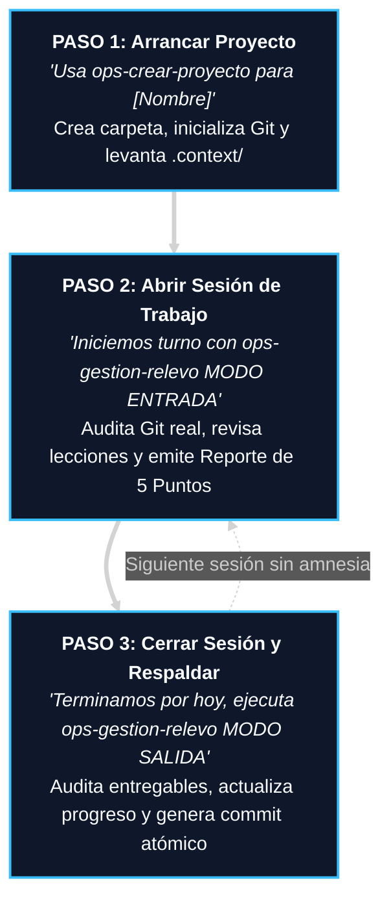
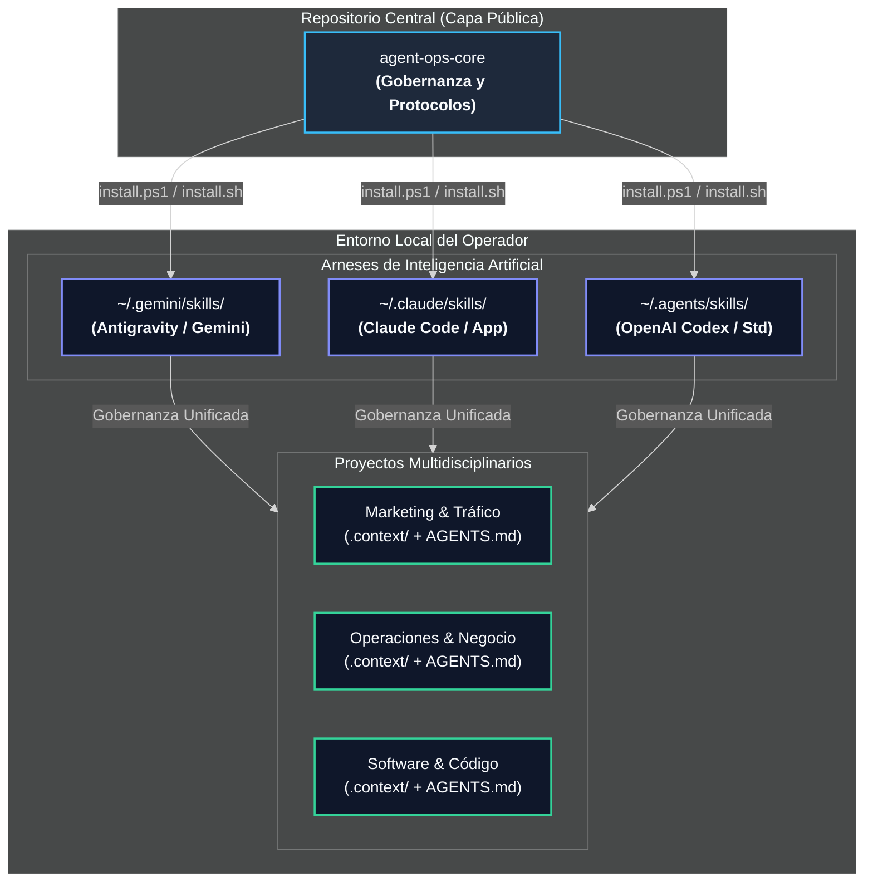
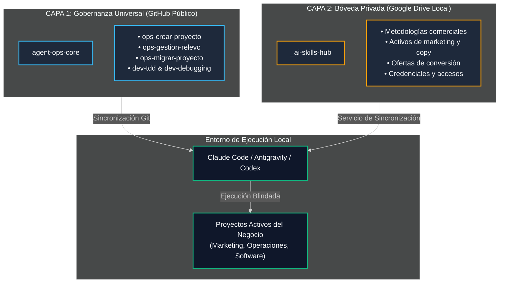

<div align="center">

# Agent Ops Core

### El Sistema de Memoria Persistente y Gobernanza Operativa para Equipos de Inteligencia Artificial.

**Deja de quemar horas reexplicando tu negocio en cada chat. Dale a tu IA una memoria física indestructible en Git, verificación de avances sin complacencia y cero amnesia entre sesiones.**

[-818cf8?style=flat-square)]()
[]()
[-10b981?style=flat-square)]()
[](LICENSE)
[](#el-catalogo-de-las-6-skills-operativas-incluidas)

[Arranque en 60s](#como-arrancar-este-sistema-en-60-segundos-cero-codigo) · [Flujo Diario en 3 Pasos](#el-flujo-de-trabajo-diario-en-3-pasos) · [Garantía Antirriesgo](#tus-archivos-y-tu-memoria-estan-a-salvo) · [Los 4 Cuellos de Botella](#los-cuatro-cuellos-de-botella-que-destruyen-tu-productividad-con-ia) · [Diagramas](#neutralidad-multiagente-y-distribucion-simetrica) · [Los 6 Protocolos](#los-seis-protocolos-universales-de-agentsmd) · [Aviso Legal](#licencia-y-aviso-legal-de-independencia)

</div>

> [!IMPORTANT]
> **Tus Archivos y tu Memoria Están a Salvo:**
> Toda IA dejada a su suerte improvisa supuestos, inventa conclusiones complacientes y olvida el contexto al cerrar la ventana. **Agent Ops Core** impone un estándar físico: ningún agente puede afirmar que una tarea está terminada sin evidencia comprobable, ningún archivo se modifica a ciegas y la memoria histórica de tu negocio queda blindada localmente bajo control de versiones Git y respaldo cloud.

---

## Cómo Arrancar este Sistema en 60 Segundos (Cero Código)

No necesitas ser programador, compilar dependencias ni memorizar comandos de terminal. Elige la vía que mejor se adapte a tu forma de trabajar:

### Método 1: La Vía Directa en Chat (100% Sin Terminal)

Si utilizas **Claude Desktop**, **ChatGPT**, **Gemini**, **Cursor** o **Antigravity**, copia y pega este bloque en el chat de tu IA para activar el protocolo de inmediato:

```text
Actúa como mi Ingeniero de Operaciones y Gobernanza de Proyectos. 

Quiero que trabajemos bajo el estándar universal de AGENTS.md del repositorio público https://github.com/eddvasquez/agent-ops-core.

Por favor realiza lo siguiente de forma estricta:
1. Revisa las directrices públicas de https://raw.githubusercontent.com/eddvasquez/agent-ops-core/main/README.md y los 6 Protocolos de AGENTS.md.
2. Si tienes acceso a mi terminal o herramientas locales, ejecuta el comando de instalación de 1 línea para mi sistema operativo (Windows o Mac/Linux) para instalar las skills operativas en mis carpetas locales (~/.gemini, ~/.claude o ~/.agents).
3. Si estamos operando exclusivamente en esta ventana de chat sin herramientas locales, adopta inmediatamente el Protocolo 1 (MODO ENTRADA): audita el estado actual de nuestro objetivo, revisa qué directrices previas tenemos y entrégame el Reporte de 5 Puntos antes de realizar cualquier cambio, redacción o propuesta.
```

---

### Método 2: Instalación Permanente en tu Computadora (1 Solo Comando)

Si deseas que todas tus sesiones locales de Claude Code, Antigravity o Codex compartan automáticamente las skills maestras y se auto-actualicen cada 24 horas:

#### En Windows (PowerShell):
```powershell
irm https://raw.githubusercontent.com/eddvasquez/agent-ops-core/main/install.ps1 | iex
```

#### En macOS y Linux (Terminal):
```bash
curl -fsSL https://raw.githubusercontent.com/eddvasquez/agent-ops-core/main/install.sh | bash
```

> [!TIP]
> **Detección Automática de Nube:** El instalador detecta si cuentas con Google Drive o almacenamiento cloud configurado, valida la sincronización y registra un proceso de actualización diaria silenciosa sin interrumpir tu trabajo.

---

## El Flujo de Trabajo Diario en 3 Pasos

Una vez activado el sistema, así operas en el día a día para mantener disciplina absoluta en proyectos de **marketing digital, consultoría, finanzas, operaciones o software**:



### 1. Paso 1: Arrancar un Proyecto Nuevo
Dile a tu IA:
> *"Usa `ops-crear-proyecto` para inicializar el proyecto [Nombre de tu Proyecto]"*

La IA creará la estructura limpia, verificará que el directorio esté respaldado en tu almacenamiento cloud (evitando pérdidas por daño de disco), inicializará el repositorio Git local protegido y creará la carpeta `.context/` con los 5 archivos de memoria persistente.

### 2. Paso 2: Abrir Turno de Trabajo (Modo Entrada)
Al comenzar el día o abrir un nuevo chat, dile:
> *"Iniciemos sesión con `ops-gestion-relevo` MODO ENTRADA"*

La IA tiene prohibido tocar archivos o sugerir cambios de inmediato. Primero ejecuta `git status -s` y `git log -n 3`, lee la memoria de `activeContext.md` y las lecciones aprendidas, y te entrega el **Reporte de 5 Puntos** (auditoría Git, directrices vigentes, habilidades disponibles, discrepancias detectadas y siguiente paso inmediato). Tú sólo respondes "OK" para autorizar el avance.

### 3. Paso 3: Cerrar Turno y Relevar (Modo Salida)
Al terminar tu jornada o antes de cerrar el chat, dile:
> *"Terminamos por hoy, ejecuta `ops-gestion-relevo` MODO SALIDA"*

La IA audita qué tareas se cumplieron objetivamente, documenta cualquier error o directriz nueva en `lessons_learned.md`, actualiza con precisión quirúrgica el archivo `activeContext.md` para el próximo turno y genera el commit atómico de relevo en Git con pausa de seguridad para la sincronización en la nube.

---

## Los Cuatro Cuellos de Botella que Destruyen tu Productividad con IA

### 1. La Amnesia de Turno y la Reexplicación Crónica
- **El Coste:** En cada nuevo chat, la IA olvida el perfil del cliente, las cifras de la oferta, el tono de marca y las objeciones previas. El operador pierde entre 20 y 45 minutos repitiendo antecedentes.
- **La Solución Agent Ops:** Memoria persistente en Markdown nativo (`.context/`). La IA lee el estado exacto antes de escribir una sola palabra.

### 2. La Complacencia del Falso Avance
- **El Coste:** El modelo afirma con entusiasmo que un copy, un informe de mercado o un script de ventas está "listo", pero al inspeccionarlo contiene datos genéricos, números inventados o instrucciones a medio hacer.
- **La Solución Agent Ops:** Mandato anti-complacencia. Queda prohibido marcar hitos como terminados sin evidencia física comprobable y contrastada contra criterios objetivos de éxito.

### 3. La Modificación Especulativa (Parches a Ciegas)
- **El Coste:** Ante un error o retroalimentación, la IA pide disculpas serviles y altera variables al azar (*shotgun approach*), dañando la coherencia del resto de entregables.
- **La Solución Agent Ops:** Depuración sistemática en 4 fases: aislamiento del síntoma, análisis de causa raíz, hipótesis única y corrección quirúrgica controlada.

### 4. La Dispersión de Datos y la Vulnerabilidad Cloud
- **El Coste:** Archivos dispersos sin versionar, versiones duplicadas informales (`brief_final_v2.docx`) y riesgo de pérdida absoluta si la plataforma del proveedor sufre una caída o bloquea la cuenta.
- **La Solución Agent Ops:** Neutralidad e independencia total. El conocimiento y la memoria residen en tu máquina y tu nube bajo Git, legibles por cualquier IA de hoy o de mañana.

---

## Comparativa de Rendimiento Operativo

| Dimensión | Operación Sin Gobernanza (Tradicional) | Operación Con Agent Ops Core |
| :--- | :--- | :--- |
| **Continuidad entre Sesiones** | Amnesia recurrente; el usuario debe reexplicar el contexto en cada turno. | Protocolo de Relevo (Modo Entrada): auditoría del estado real y confirmación de foco. |
| **Calidad de Entregables** | Contenido genérico y complaciente sin verificación rigurosa. | Validación contra criterios de éxito explícitos y memoria de lecciones aprendidas. |
| **Resolución de Incidencias** | Modificaciones a ciegas (*shotgun approach*) que generan retrabajos. | Análisis determinista de causa raíz antes de intervenir cualquier activo. |
| **Independencia Tecnológica** | Dependencia absoluta del ecosistema de un solo proveedor. | Neutral: Las mismas reglas operan idénticas en Claude, Gemini, ChatGPT y terminales locales. |
| **Seguridad de Archivos** | Riesgo de pérdida por daño físico o sobreescritura accidental. | Auditoría automática de almacenamiento en la nube y versionado Git protegido. |

---

## El Catálogo de las 6 Skills Operativas Incluidas

| Skill | Tipo | Función Crítica y Resultado Operativo |
| :--- | :---: | :--- |
| **`ops-crear-proyecto`** | Operación | Inicializa proyectos nuevos con arquitectura v2, Git protegido y auditoría preventiva de respaldo en Google Drive/Cloud. |
| **`ops-gestion-relevo`** | Gobernanza | Ejecuta el protocolo de relevo diario (Modo Entrada y Modo Salida) con auto-actualización silenciosa cada 24 horas. |
| **`ops-migrar-proyecto`** | Operación | Convierte proyectos legados o desordenados a la arquitectura universal v2 sin destruir datos ni duplicar archivos. |
| **`ops-git-worktrees`** | Operación | Gestiona directorios de trabajo paralelos en Git para abordar tareas simultáneas sin bloqueos de ramas. |
| **`dev-tdd`** | Calidad | Implementa metodología Test-Driven Development (Red-Green-Refactor) para entregables verificados con pruebas. |
| **`dev-systematic-debugging`** | Resolución | Metodología de 4 fases para investigar y resolver incidencias de causa raíz sin parches a ciegas. |

---

## Neutralidad Multiagente y Distribución Simétrica

El sistema de gobernanza reside en una capa independiente y universal. Ningún arnés ni empresa de IA es propietaria de tu estructura de trabajo:



---

## Arquitectura de Trabajo en Dos Capas

El framework separa de forma estricta los procesos operativos de los activos propietarios del negocio:



1. **Capa 1: Marco de Gobernanza (`agent-ops-core` en GitHub):**
   - Protocolo universal `AGENTS.md`.
   - Inicializador de proyectos multidisciplinarios (`ops-crear-proyecto`).
   - Gestión de relevos y recepción/cierre de turnos (`ops-gestion-relevo`).
   - Estandarización y rescate de proyectos legados (`ops-migrar-proyecto`).
   - Aislamiento de tareas paralelas (`ops-git-worktrees`).
   - Protocolos de verificación y depuración de causa raíz.

2. **Capa 2: Bóveda Privada de Negocio (Almacenamiento Local Respaldado):**
   - Habilidades propietarias de la empresa: marcos de consultoría, ángulos de adquisición, guiones comerciales y credenciales.
   - Reside exclusivamente en tu almacenamiento respaldado y privado, sin exposición en repositorios públicos.
   - Servicios de sincronización en segundo plano unifican ambas capas en los arneses de IA en tiempo real.

---

## Ciclo de Vida Operativo: Protocolo de Relevo

Así interactúan el operador, los agentes de Inteligencia Artificial y el control de versiones en cada turno de trabajo:


---

## Los Seis Protocolos Universales de AGENTS.md

Todo proyecto iniciado con este framework incluye un archivo rector `AGENTS.md` con seis reglas innegociables:

1. **Protocolo 1 (Inicio de Turno / Auditoría de Estado):** Prevalencia de la evidencia física de Git y los registros de contexto sobre suposiciones verbales. Reporte de 5 puntos obligatorio antes de modificar activos.
2. **Protocolo 2 (Cero Suposiciones y Memoria Cruda):** Prohibido adivinar requerimientos o directrices del cliente. Toda corrección humana se registra cronológicamente en `.context/lessons_learned.md`.
3. **Protocolo 3 (Invocación Mandatoria y Anti-Racionalización):** Prohibido omitir habilidades o metodologías probadas con excusas de premura.
4. **Protocolo 4 (Destilación de Conocimiento):** Las reglas operativas que demuestren valor universal se abstraen hacia habilidades maestras reutilizables.
5. **Protocolo 5 (Escritor Único e Higiene en la Nube):** Un único agente activo por turno para prevenir colisiones; prohibición de archivos duplicados; pausas de seguridad para liberar bloqueos de sincronización en la nube.
6. **Protocolo 6 (Cierre de Turno y Relevo):** Auditoría objetiva de tareas terminadas antes de actualizar el progreso y generación de commit atómico de relevo.

---

## Licencia y Aviso Legal de Independencia

Este proyecto está distribuido bajo la Licencia [Apache 2.0](LICENSE).

**Aviso de Independencia y Marcas:** Agent Ops Core es un marco de gobernanza independiente desarrollado por Edd Vásquez. No está afiliado, patrocinado, respaldado ni certificado por Google LLC, Anthropic PBC, OpenAI ni ninguna de sus entidades filiales. Todas las marcas registradas y nombres de productos mencionados pertenecen a sus respectivos titulares.
