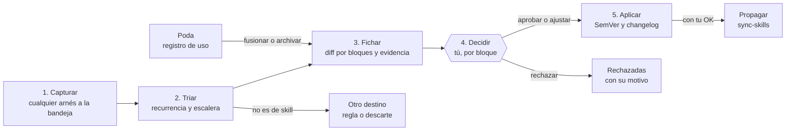

# Aprendizaje gobernado de skills en Agent Ops Core

2026-11-20 · Edd Vásquez · Versión editable: https://claude.ai/artifact/4k3E7kgX62W9nERfGEsFq9

## Resumen ejecutivo

Recomiendo que Agent Ops Core aprenda con fichas de propuesta que tú apruebas por bloques, no con skills que el agente escribe solo, y que por defecto prefiera no crear skills.

- **El problema real** no es detectar aprendizajes: tus proyectos ya los detectan (tres «candidatas a skill global» en mcp meta ads nunca se decidieron). Falta un circuito que los lleve de la captura a una decisión.
- **La evidencia avala la intervención humana.** En SkillsBench, las skills curadas suben 16 puntos y las autogeneradas no aportan nada. Hermes, el arnés más automático, necesitó un curador porque sin él acumula «docenas de casi-duplicados».
- **La propuesta:** capturar en el momento desde cualquier arnés, triar con una escalera de cinco destinos, presentar una ficha con diff por bloques, aplicar solo lo aprobado con SemVer y changelog, y podar cada trimestre.
- **Contra la acumulación:** techo inicial de 25 skills, umbral de cuatro condiciones para crear y cambios pequeños por ítem, nunca reescrituras completas (ACE muestra que reescribir colapsa el contexto).
- **Sin skill nueva:** el circuito se añade a `ops-session-handoff` y a scripts del hub, y exige revisar el Protocolo 3.

## Requisitos acordados

El sistema aprende con propuestas que el humano aprueba, nunca solo; y por defecto prefiere no crear skills. Requisitos fijados en la entrevista del 2026-11-20 (reglas R-003 y R-004 del proyecto):

| # | Tema | Decisión |
| --- | --- | --- |
| 1 | Alcance | Lo de un proyecto o cliente va a `reglas_proyecto.md`; lo que vale para varios proyectos se propone a una skill. |
| 2 | Señales | Correcciones del usuario, fallos de una skill, patrones repetidos y éxitos reutilizables. |
| 3 | Momento | Capturar en el momento sin interrumpir; decidir al cierre o en revisión por lotes. |
| 4 | Aprobación | Ficha completa (texto exacto, porqué, evidencia, riesgo, versión); aprobación parcial por cambio. |
| 5 | Ubicación | Bandeja central de propuestas en `_ai-skills-hub`. |
| 6 | Skills afectables | Propias y del marco; las de terceros solo con un complemento propio, sin tocar el original. |
| 7 | Validación | Según riesgo: caso real para cambios menores; pruebas antes/después para cambios de comportamiento y skills nuevas. |
| 8 | Arneses | Todos capturan y cualquiera presenta; solo archivos y scripts (R-002). |
| 9 | Tras aprobar | El agente aplica, versiona, escribe changelog y hace commit; propagar se confirma aparte. |
| 10 | Entregable | Este documento: investigación y propuesta de arquitectura, antes de implementar. |
| 11 | Casos | Extraídos por el agente, en solo lectura, de lecciones y conversaciones. |
| 12 | Anti-acumulación | Escalera de destinos y umbral alto para crear; techo, métricas y poda los propone la investigación. |

## Casos reales del usuario

En 18 proyectos con `lessons_learned.md`, los aprendizajes sí se detectan, pero no hay un circuito que los lleve a una decisión. Cinco casos que servirán de pruebas del diseño:

| Caso | Proyecto | Qué pasó | Qué revela |
| --- | --- | --- | --- |
| A. Candidatas huérfanas | mcp meta ads | Tres lecciones marcadas «Candidata a skill global» (tests de wire, contrato de fidelidad F1–F10, confirmación por frase exacta) que aplican también a los MCP de Google Ads y GTM. Ninguna se propuso ni se decidió. | Se detecta, pero no hay bandeja ni ficha: la marca queda enterrada en un proyecto. |
| B. Fuentes contradictorias | mcp GTM, google-ads-mcp | `AGENTS.md` exigía `Nombre (ID: X)` y la skill usaba `Nombre [Tag X]`; cada agente seguía el que leía primero. Se corrigió a mano en dos skills y un servidor. | Un aprendizaje puede tocar varias skills a la vez; hace falta detectar contradicciones antes de proponer. |
| C. Deriva fuera del hub | mcp GTM | `SKILL.md` listaba 75 de 95 herramientas; una edición hecha en `.gemini` nunca volvió al hub. | Las mejoras deben nacer como propuesta en el hub, nunca como edición directa en un arnés. |
| D. Mejora bien hecha | Ana Maria Tre | Mejoras a `google-ads-palabras-clave-nuevas` con confirmación humana y pruebas (Hub `34675e6`, 170 pruebas). Antes se confundió «ajustar la skill» con «reorganizar las cuentas». | El patrón correcto ya existe a mano: confirmación + pruebas + commit. Falta separar mejorar la herramienta de operar con ella. |
| E. Engorde de una skill | gtm-media-buyer-orchestrator | Su descripción, que se carga en cada sesión, enumera 113 herramientas, 10 clusters y 6 fases. | La acumulación también ocurre dentro de una skill: la descripción crece con cada mejora. |

## Cómo lo resuelven los arneses

Los arneses que mejor gestionan el aprendizaje separan capturar de aplicar y tienen un proceso de poda; ninguno lo resuelve solo creando skills.

| Arnés | Cómo captura | Quién aprueba | Control de acumulación | Qué tomamos |
| --- | --- | --- | --- | --- |
| [Hermes Agent](https://hermes-agent.nousresearch.com/docs/user-guide/features/skills) | Tras flujos de varios pasos, errores o correcciones del usuario; una revisión en segundo plano cada ~10 turnos. Edita con parches `old_string`/`new_string`. | Automático por defecto (`write_approval: false`). Con `true`, todo queda en `pending/` con `diff`, `approve` y `reject`. | [Curator](https://hermes-agent.nousresearch.com/docs/user-guide/features/curator): contador de vistas, usos y parches; marca obsoletas a 14 días y archiva a 30, nunca borra; `pin` y `lock` protegen skills. | Bandeja de pendientes con diff, parches pequeños, contador de uso, archivo sin borrado, `pin`. Rechazamos su valor por defecto automático. |
| [Devin](https://docs.devin.ai/use-cases/gallery/scheduled-knowledge-maintenance.md) | Sugiere conocimiento a partir de tu feedback en el chat. | «No aplica cambios automáticamente»: propone crear, fusionar y borrar, y apruebas cada uno. | Sesión semanal que fusiona duplicados, resuelve contradicciones y marca entradas obsoletas. [Migra Knowledge a Skills](https://docs.devin.ai/product-guides/knowledge.md). | La revisión semanal en lote y que las propuestas incluyan fusionar y retirar, no solo añadir. |
| [Letta](https://www.letta.com/blog/skill-learning/) | Reflexión sobre trayectorias pasadas y luego un agente que redacta la skill. | Sin revisión humana descrita. | No descrito. | La señal de verificación mejora mucho las skills: +15,7 puntos frente a +9 sin ella en Terminal Bench 2.0. |
| [Cursor](https://docs.cursor.com/context/memories) | Un modelo lateral extrae memorias de la conversación. | Según fuentes secundarias, se aprueban antes de guardarse. | Separa reglas escritas (autoridad) de memorias derivadas (revisables). | La misma separación que ya tenemos: `reglas_proyecto.md` manda; lo capturado es candidato. |
| [Claude / Agent Skills](https://platform.claude.com/docs/en/agents-and-tools/agent-skills/best-practices.md) | Desarrollo guiado por evaluaciones: ver dónde falla el modelo sin skill y escribir lo mínimo. | Humano autor (Claude A diseña, Claude B prueba). | «La ventana de contexto es un bien público»; `SKILL.md` de menos de 500 líneas; descripción de 1.024 caracteres como máximo. | Probar sin skill primero y exigir el mínimo texto que cierre la brecha. |

El dato más útil viene del propio Hermes: sin curación se acaba con «docenas de casi-duplicados estrechos que contaminan el catálogo y gastan tokens».

## Qué dice la investigación

La evidencia respalda tu criterio: las skills que el modelo escribe solo no ayudan de media; las curadas sí, y los cambios pequeños y acumulativos superan a las reescrituras.

| Trabajo | Hallazgo | Implicación para Agent Ops Core |
| --- | --- | --- |
| [SkillsBench](https://arxiv.org/abs/2602.12670) (2026) | Skills curadas: +16 puntos de media. Autogeneradas: sin beneficio (−1,3). 16 de 84 tareas empeoraron incluso con skills curadas. Skills enfocadas de 2–3 módulos superan a la documentación exhaustiva. | El humano curador no es un freno: es la causa del beneficio. Una skill también puede empeorar resultados. |
| [ACE](https://arxiv.org/html/2510.04618v3) (ICLR 2026) | Tres roles: Generator, Reflector, Curator. Cambios como «deltas» por ítem con contadores de útil/dañino. Reescribir el contexto entero lo colapsó de 18.282 a 122 tokens y la precisión cayó de 66,7 a 57,1. | Proponer parches por ítem, nunca reescribir una skill entera. Igual que ya hacemos con `reglas_proyecto.md` (Protocolo 8). |
| [ExpeL](https://arxiv.org/abs/2308.10144) (AAAI 2024) | Extrae «insights» en lenguaje natural de muchas experiencias y los mantiene; insights más ejemplos superan a cada uno solo. | Una lección gana peso cuando se repite en varias experiencias, no en la primera. |
| [Voyager](https://arxiv.org/abs/2305.16291) (2023) | Solo guarda en la biblioteca lo que funcionó y pasó verificación. | Ninguna skill nueva sin un caso verificado que la respalde. |
| [Letta skill learning](https://www.letta.com/blog/skill-learning/) (2025) | La reflexión con verificador añade 6,7 puntos sobre la reflexión sola. | La ficha debe traer evidencia verificable, no solo la opinión del agente. |
| [Sobre cuántas herramientas ver](https://arxiv.org/abs/2605.24660) (2026) | La precisión de selección cae con el tamaño del catálogo; listas cortas y adaptativas rinden mejor (93,1 % frente a 87,1 %). | Cada skill compite por ser elegida; el catálogo debe ser pequeño y sin solapamientos. |

Dos matices: SkillsBench mide skills escritas antes de intentar la tarea, y casi todas las cifras vienen de los propios autores, sin réplica independiente.

## Riesgo de acumulación de skills

Propongo un techo de 25 skills propias activas (hoy hay 21), con un umbral de creación de cuatro condiciones y una poda trimestral que propone archivar, nunca borra.

Por qué el riesgo es real aquí:

- Las descripciones de todas las skills se cargan en cada sesión. En Claude Code, fuentes comunitarias describen un [presupuesto de listado](https://dev.to/rulestack/too-many-claude-code-skills-how-the-listing-budget-decides-which-descriptions-claude-sees-4a6m) que recorta descripciones o descarta skills en silencio al superarse. No es documentación oficial.
- La selección empeora con catálogos grandes y solapados (sección anterior). Ya hay solapamientos: tres skills de Google Ads y GTM, y dos de UI con Impeccable.
- El Protocolo 3 obliga a invocar una skill con ≥ 1 % de probabilidad de ayudar. Con más skills, esa regla empuja a seguir recetas en vez de razonar. SkillsBench confirma que una skill puede empeorar el resultado.

**Escalera de destinos.** Cada aprendizaje sube solo hasta el primer peldaño que lo resuelve:

1. Nada: el modelo ya lo hace bien razonando, o fue un caso aislado.
2. Regla de proyecto en `reglas_proyecto.md`: vale para un proyecto o cliente.
3. Parche a una skill existente: una línea o un paso en su dominio.
4. Archivo de referencia dentro de una skill: detalle que solo se lee cuando hace falta y no ocupa la descripción.
5. Skill nueva: solo si pasa el umbral.

**Umbral para crear una skill nueva** (las cuatro a la vez):

- Repetida en al menos dos proyectos o tres sesiones distintas.
- Evidencia de que el modelo lo hace peor sin ella (prueba antes y después).
- No cabe como parche o referencia de ninguna skill existente.
- Su descripción no se solapa con la de otra skill.

**Límites propuestos**

| Límite | Valor propuesto | Fuente |
| --- | --- | --- |
| Skills propias activas | 25; por encima, crear exige fusionar o archivar otra | Selección de herramientas y presupuesto de listado |
| Descripción | 300 caracteres, disparadores primero | Recorte de descripciones; límite oficial 1.024 |
| Cuerpo de `SKILL.md` | 500 líneas; el resto a referencias | Guía oficial de Anthropic |
| Ritmo de cambios | Un lote por skill por ciclo semanal | Revisión semanal de Devin |
| Tamaño del parche | Cada propuesta declara líneas añadidas y quitadas | Colapso de contexto en ACE |
| Poda | Trimestral; sin uso en 90 días, propuesta de archivo | Curator de Hermes (archiva, nunca borra) |

El techo de 25 es un punto de partida, no una cifra medida: se ajusta cuando haya datos de uso reales.

## Propuesta de arquitectura para Agent Ops Core

Un circuito en cinco etapas (capturar, triar, fichar, decidir y aplicar) que vive en archivos del hub y en scripts de terminal, sin crear ninguna skill nueva: se amplía `ops-session-handoff`.

Las propuestas solo avanzan hacia la derecha si tú las apruebas; la poda vuelve a entrar como ficha y pasa por la misma decisión.

**Etapas**

1. **Capturar** (cualquier arnés, en el momento). `capture-learning.ps1` escribe una candidata en `_ai-skills-hub/proposals/inbox/` con: señal (corrección, fallo, patrón o éxito), proyecto, fecha, arnés, evidencia breve y skill que parece afectada. No toca ninguna skill y no interrumpe el trabajo.
2. **Triar** (al cierre o en lote). `triage-learnings.ps1` agrupa candidatas del mismo tema, suma su recurrencia entre proyectos y aplica la escalera de destinos. Lo que es de un proyecto se deriva a `reglas_proyecto.md`; lo que no supera el peldaño 1 se descarta con motivo.
3. **Fichar.** Cada propuesta superviviente se convierte en una ficha en `proposals/pending/<id>.md` (formato abajo). Si el riesgo es medio o alto, la ficha no se presenta sin su prueba antes y después.
4. **Decidir** (humano, desde cualquier arnés). Por cada bloque del parche: aprobar, ajustar, rechazar o aplazar. Lo rechazado pasa a `proposals/rejected/` con su motivo, para que no se vuelva a proponer igual.
5. **Aplicar y versionar.** `apply-proposal.ps1` aplica solo los bloques aprobados en el hub, sube SemVer, escribe `changelogs/<skill>.md` y hace commit con `commit.ps1`. Propagar a máquinas y arneses sigue siendo `sync-skills.ps1`, con confirmación aparte.

Un sexto proceso, la **poda trimestral**, lee el registro de uso y genera fichas de fusión o archivo que pasan por la misma decisión. El uso se registra en MODO SALIDA con `record-usage.ps1` (qué skills se invocaron y si ayudaron), porque R-002 descarta hooks.

**Ficha de propuesta**

| Campo | Contenido |
| --- | --- |
| Destino | Peldaño de la escalera y por qué no basta uno inferior |
| Skill y versión | `nombre` 1.4.2 → 1.5.0, con justificación SemVer |
| Cambio exacto | Diff por bloques numerados, aprobables por separado |
| Por qué | El problema en una o dos frases |
| Evidencia | Casos concretos: proyecto, fecha, sesión, recurrencia |
| Riesgo y validación | Bajo, medio o alto; prueba antes y después si no es bajo |
| Tamaño | Líneas añadidas y quitadas; cambio en la descripción |
| Solapamientos | Skills o reglas que tocan lo mismo y contradicciones detectadas |
| Alternativas descartadas | Qué otro destino se valoró y por qué no |

**Cambios a los protocolos**

- Protocolo 3: cambiar «≥ 1 % de probabilidad» por «la tarea entra en el dominio que declara la descripción de la skill». Así se mantiene la obligación donde aplica y se deja razonar fuera de ella.
- Protocolo 4: sustituir «proponer destilación» por el circuito completo, con la escalera y el umbral como requisito.
- Protocolo 6 y `ops-session-handoff` MODO SALIDA: añadir capturar, triar y presentar fichas pendientes, y registrar el uso.

**Fases de implementación**, todas con `dev-tdd`:

1. Bandeja, formato de ficha y captura manual («esto es una candidata»). Los cinco casos reales como primeras pruebas.
2. Triaje con recurrencia y escalera; `apply-proposal.ps1` con aprobación parcial y versionado.
3. Registro de uso, poda trimestral y comprobación de solapamientos entre descripciones.

## Decisiones abiertas y siguientes pasos

Cinco decisiones bloquean la fase 1; el resto puede esperar a tener datos.

- [ ] Aprobar o ajustar los límites: techo de 25 skills, descripción de 300 caracteres, un lote semanal por skill, poda a 90 días.
- [ ] Aprobar el cambio del Protocolo 3 («≥ 1 %» → «dominio declarado»). Cambia el comportamiento esperado del agente, así que por el Protocolo 7 sería una versión MAJOR del marco (3.0.0).
- [ ] Confirmar que la bandeja vive en `_ai-skills-hub/proposals/` y se versiona en el Git del hub.
- [ ] Decidir cuándo se revisan las fichas: al cierre de cada sesión, solo en la revisión semanal, o ambas.
- [ ] Aceptar que el registro de uso es declarado por el agente en MODO SALIDA: sin hooks (R-002) no hay medición automática.

Con esas decisiones, el siguiente paso ejecutable es la fase 1 con `dev-tdd`: escribir primero las pruebas del formato de ficha y de `capture-learning.ps1` usando los cinco casos reales, y después implementar.

## Fuentes

- [Hermes Agent: Skills](https://hermes-agent.nousresearch.com/docs/user-guide/features/skills) y [Curator](https://hermes-agent.nousresearch.com/docs/user-guide/features/curator)
- [Devin: mantenimiento programado del conocimiento](https://docs.devin.ai/use-cases/gallery/scheduled-knowledge-maintenance.md) y [Knowledge](https://docs.devin.ai/product-guides/knowledge.md)
- [Letta: skill learning](https://www.letta.com/blog/skill-learning/)
- [Cursor: Memories](https://docs.cursor.com/context/memories)
- [Anthropic: Skill authoring best practices](https://platform.claude.com/docs/en/agents-and-tools/agent-skills/best-practices.md)
- [SkillsBench (arXiv 2602.12670)](https://arxiv.org/abs/2602.12670)
- [ACE (arXiv 2510.04618)](https://arxiv.org/html/2510.04618v3) y [repositorio](https://github.com/ace-agent/ace)
- [ExpeL (arXiv 2308.10144)](https://arxiv.org/abs/2308.10144)
- [Voyager (arXiv 2305.16291)](https://arxiv.org/abs/2305.16291)
- [How Many Tools Should an LLM Agent See? (arXiv 2605.24660)](https://arxiv.org/abs/2605.24660)
- [Presupuesto de listado de skills en Claude Code (comunitario)](https://dev.to/rulestack/too-many-claude-code-skills-how-the-listing-budget-decides-which-descriptions-claude-sees-4a6m)
