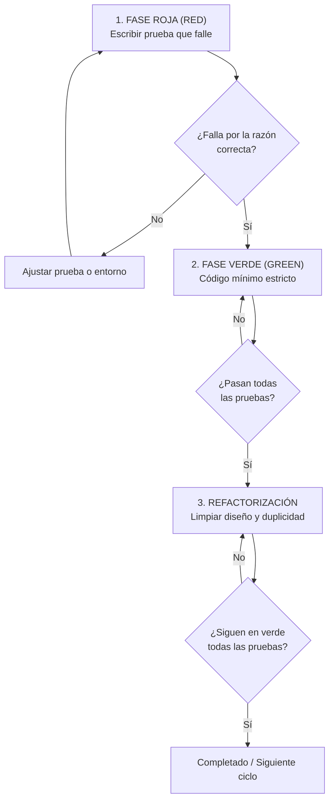

# Skill: Desarrollo Guiado por Pruebas (TDD)

## Propósito y Filosofía
Esta skill asegura que toda nueva funcionalidad o modificación estructural de código sea concebida, verificada y protegida mediante pruebas automatizadas ejecutadas antes de escribir la lógica de negocio.
- **Regla inquebrantable:** Prohibido escribir código de producción sin una prueba previa que haya fallado legítimamente.
- **Integridad de pruebas:** Prohibido debilitar aserciones, suprimir errores en tests o escribir pruebas triviales para simular cobertura ficticia.

---

## EL CICLO DETERMINISTA RED-GREEN-REFACTOR

---

### FASE 1: ROJO (RED) — ESCRIBIR LA PRUEBA
1. **Definir el contrato:**
   - Seleccionar una sola unidad de comportamiento o caso de uso atómico.
   - Diseñar la interfaz deseada (nombres de funciones, argumentos de entrada, tipos retornados, excepciones esperadas) desde la perspectiva del consumidor.
2. **Escribir la prueba:**
   - Crear el test en la suite de pruebas del proyecto (`tests/`, `__tests__/`, o script específico del stack).
   - Utilizar aserciones claras y unívocas sobre el resultado observable.
3. **Comprobar el fallo:**
   - Ejecutar la prueba. **Debe fallar.**
   - Verificar minuciosamente que falle por la razón esperada (e.g., `FunctionNotFound`, `AssertionError: expected X but got Y`), no por un error de sintaxis en el test o por problemas del entorno.

---

### FASE 2: VERDE (GREEN) — IMPLEMENTACIÓN MÍNIMA
1. **Código estrictamente necesario:**
   - Escribir la cantidad mínima de código en el archivo fuente para hacer que la prueba recién escrita pase.
   - Se permite código simple e incluso valores hardcodeados temporales si es el primer paso para validar la estructura.
2. **Prohibición de sobre-ingeniería:**
   - Prohibido agregar abstracciones prematuras, parámetros no testeados o lógica para casos futuros que aún no tienen una prueba roja asociada.
3. **Verificación:**
   - Ejecutar la suite de pruebas. El test debe pasar al 100% en conjunto con las pruebas anteriores.

---

### FASE 3: REFACTORIZACIÓN (REFACTOR) — HIGIENE DEL CÓDIGO
1. **Mejorar sin romper:**
   - Eliminar duplicación de código (DRY).
   - Mejorar nombres de variables y funciones para que revelen claramente su intención.
   - Extraer métodos o constantes si la legibilidad lo amerita.
2. **Seguridad constante:**
   - Tras cada pequeña refactorización, re-ejecutar inmediatamente la suite de pruebas. Si algo se rompe, revertir el cambio de inmediato.
3. **Criterio de salida:**
   - El código es limpio, expresivo y todas las pruebas continúan pasando en verde de forma determinista.
